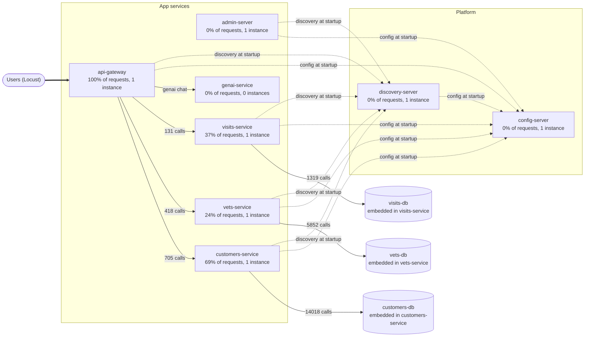

# Dependency map

Generated 2026-10-10 16:42:21. Source-backed relationships are reconciled with Docker Compose, Eureka, Zipkin, Prometheus and Locust observations. Missing telemetry is unknown, not zero impact. Dashed arrows are startup dependencies or manual corrections.

## Services

| Service | Role | Share of user requests | Instances | Auto-restart | Needs at startup | Risk hints |
|---|---|---|---|---|---|---|
| api-gateway | entry point | 100% | 1 | no | config-server, discovery-server | single instance; no auto-restart; on 100% of user requests |
| customers-service | service | 69% | 1 | no | config-server, discovery-server | single instance; no auto-restart; on 69% of user requests |
| customers-db | datastore | 40% | unknown | n/a | - | embedded: fails and restarts together with customers-service; on 40% of user requests |
| visits-service | service | 37% | 1 | no | config-server, discovery-server | single instance; no auto-restart; on 37% of user requests |
| vets-service | service | 24% | 1 | no | config-server, discovery-server | single instance; no auto-restart; on 24% of user requests |
| vets-db | datastore | 24% | unknown | n/a | - | embedded: fails and restarts together with vets-service; on 24% of user requests |
| visits-db | datastore | 8% | unknown | n/a | - | embedded: fails and restarts together with visits-service; on 8% of user requests |
| admin-server | service | 0% | 1 | no | config-server, discovery-server | single instance; no auto-restart |
| config-server | platform | 0% | 1 | no | - | single instance; no auto-restart; 6 services need it to start |
| discovery-server | platform | 0% | 1 | no | config-server | single instance; no auto-restart; 5 services need it to start |
| genai-service | service | 0% | 0 | no | config-server, discovery-server | inactive profile |

## User actions (data flows)

| User action | Route | Share of requests | Passes through | Source |
|---|---|---|---|---|
| list owners | `/api/customer/owners` | 33% | api-gateway -> customers-service | traces (576 traces) |
| owner details | `/api/gateway/owners/\d+` | 29% | api-gateway -> customers-service -> visits-service | manual correction (544 traces) |
| list vets | `/api/vet/vets` | 24% | api-gateway -> vets-service | traces (418 traces) |
| pet types | `/api/customer/petTypes` | 6% | api-gateway -> customers-service | traces (129 traces) |
| add visit | `/api/visit/owners/\d+/pets/\d+/visits` | 8% | api-gateway -> visits-service | traces (132 traces) |

## Dependency semantics

| Consumer | Provider | Feature | Purpose | Phase | Verified | If unavailable | Evidence |
|---|---|---|---|---|---|---|---|
| api-gateway | customers-service | list owners | routing | runtime | verified | Gateway route returns its 503 fallback | spring-petclinic-microservices/spring-petclinic-api-gateway/src/main/resources/application.yml; chaoslab run kill customers-service (2026-10-10); chaoslab run cpu customers-service --cpus 0.1 (2026-10-10); Zipkin dependency API |
| api-gateway | customers-service | owner details | request_data | runtime | verified | Owner lookup has no local fallback | spring-petclinic-microservices/spring-petclinic-api-gateway/src/main/java/org/springframework/samples/petclinic/api/boundary/web/ApiGatewayController.java#getOwnerDetails; chaoslab run kill customers-service (2026-10-10); chaoslab run cpu customers-service --cpus 0.1 (2026-10-10); Zipkin dependency API |
| api-gateway | visits-service | owner details | request_data | runtime | verified | Circuit breaker can supply an empty visits list | spring-petclinic-microservices/spring-petclinic-api-gateway/src/main/java/org/springframework/samples/petclinic/api/boundary/web/ApiGatewayController.java#emptyVisitsForPets; chaoslab run delay visits-service --delay-ms 600 (2026-10-10); chaoslab run loss visits-service --loss-pct 30 (2026-10-10); chaoslab run kill visits-service (2026-10-10); Zipkin dependency API |
| api-gateway | vets-service | list vets | routing | runtime | verified | Gateway route returns its 503 fallback | spring-petclinic-microservices/spring-petclinic-api-gateway/src/main/resources/application.yml; chaoslab run pause vets-service (2026-10-10); Zipkin dependency API |
| api-gateway | customers-service | pet types | routing | runtime | verified | Gateway route returns its 503 fallback | spring-petclinic-microservices/spring-petclinic-api-gateway/src/main/resources/application.yml; chaoslab run kill customers-service (2026-10-10); Zipkin dependency API |
| api-gateway | visits-service | add visit | routing | runtime | verified | Gateway route returns its 503 fallback | spring-petclinic-microservices/spring-petclinic-api-gateway/src/main/resources/application.yml; chaoslab run delay visits-service --delay-ms 600 (2026-10-10); chaoslab run loss visits-service --loss-pct 30 (2026-10-10); chaoslab run kill visits-service (2026-10-10); Zipkin dependency API |
| api-gateway | genai-service | genai chat | routing | runtime | verified | Optional chatbot route returns its 503 fallback | spring-petclinic-microservices/spring-petclinic-api-gateway/src/main/resources/application.yml |
| discovery-server | config-server | service | configuration | startup, restart | verified | Docker-profile config import fails | spring-petclinic-microservices/spring-petclinic-discovery-server/src/main/resources/application.yml; spring-petclinic-microservices/docker-compose.yml |
| discovery-server | config-server | service | configuration | runtime | unknown | Running service may retain its loaded configuration | spring-petclinic-microservices/spring-petclinic-discovery-server/src/main/resources/application.yml; spring-petclinic-microservices/docker-compose.yml |
| customers-service | config-server | service | configuration | startup, restart | verified | Docker-profile config import fails | spring-petclinic-microservices/spring-petclinic-customers-service/src/main/resources/application.yml; spring-petclinic-microservices/docker-compose.yml |
| customers-service | config-server | service | configuration | runtime | unknown | Running service may retain its loaded configuration | spring-petclinic-microservices/spring-petclinic-customers-service/src/main/resources/application.yml; spring-petclinic-microservices/docker-compose.yml |
| visits-service | config-server | service | configuration | startup, restart | verified | Docker-profile config import fails | spring-petclinic-microservices/spring-petclinic-visits-service/src/main/resources/application.yml; spring-petclinic-microservices/docker-compose.yml |
| visits-service | config-server | service | configuration | runtime | unknown | Running service may retain its loaded configuration | spring-petclinic-microservices/spring-petclinic-visits-service/src/main/resources/application.yml; spring-petclinic-microservices/docker-compose.yml |
| vets-service | config-server | service | configuration | startup, restart | verified | Docker-profile config import fails | spring-petclinic-microservices/spring-petclinic-vets-service/src/main/resources/application.yml; spring-petclinic-microservices/docker-compose.yml |
| vets-service | config-server | service | configuration | runtime | unknown | Running service may retain its loaded configuration | spring-petclinic-microservices/spring-petclinic-vets-service/src/main/resources/application.yml; spring-petclinic-microservices/docker-compose.yml |
| api-gateway | config-server | service | configuration | startup, restart | verified | Docker-profile config import fails | spring-petclinic-microservices/spring-petclinic-api-gateway/src/main/resources/application.yml; spring-petclinic-microservices/docker-compose.yml |
| api-gateway | config-server | service | configuration | runtime | unknown | Running service may retain its loaded configuration | spring-petclinic-microservices/spring-petclinic-api-gateway/src/main/resources/application.yml; spring-petclinic-microservices/docker-compose.yml |
| admin-server | config-server | service | configuration | startup, restart | verified | Docker-profile config import fails | spring-petclinic-microservices/spring-petclinic-admin-server/src/main/resources/application.yml; spring-petclinic-microservices/docker-compose.yml |
| admin-server | config-server | service | configuration | runtime | unknown | Running service may retain its loaded configuration | spring-petclinic-microservices/spring-petclinic-admin-server/src/main/resources/application.yml; spring-petclinic-microservices/docker-compose.yml |
| genai-service | config-server | service | configuration | startup, restart | verified | Docker-profile config import fails | spring-petclinic-microservices/spring-petclinic-genai-service/src/main/resources/application.yml |
| genai-service | config-server | service | configuration | runtime | unknown | Running service may retain its loaded configuration | spring-petclinic-microservices/spring-petclinic-genai-service/src/main/resources/application.yml |
| customers-service | discovery-server | service | service_discovery | runtime, restart | inferred | Registration or lookup may fail; existing addresses may remain usable | spring-petclinic-microservices/docker-compose.yml |
| customers-service | discovery-server | service | service_discovery | startup | verified | Compose startup waits for healthy Discovery | spring-petclinic-microservices/docker-compose.yml |
| visits-service | discovery-server | service | service_discovery | runtime, restart | inferred | Registration or lookup may fail; existing addresses may remain usable | spring-petclinic-microservices/docker-compose.yml |
| visits-service | discovery-server | service | service_discovery | startup | verified | Compose startup waits for healthy Discovery | spring-petclinic-microservices/docker-compose.yml |
| vets-service | discovery-server | service | service_discovery | runtime, restart | inferred | Registration or lookup may fail; existing addresses may remain usable | spring-petclinic-microservices/docker-compose.yml |
| vets-service | discovery-server | service | service_discovery | startup | verified | Compose startup waits for healthy Discovery | spring-petclinic-microservices/docker-compose.yml |
| api-gateway | discovery-server | service | service_discovery | runtime, restart | inferred | Registration or lookup may fail; existing addresses may remain usable | spring-petclinic-microservices/docker-compose.yml |
| api-gateway | discovery-server | service | service_discovery | startup | verified | Compose startup waits for healthy Discovery | spring-petclinic-microservices/docker-compose.yml |
| admin-server | discovery-server | service | service_discovery | runtime, restart | inferred | Registration or lookup may fail; existing addresses may remain usable | spring-petclinic-microservices/docker-compose.yml |
| admin-server | discovery-server | service | service_discovery | startup | verified | Compose startup waits for healthy Discovery | spring-petclinic-microservices/docker-compose.yml |
| genai-service | discovery-server | service | service_discovery | runtime, restart | inferred | Registration or lookup may fail; existing addresses may remain usable | spring-petclinic-microservices/docker-compose.yml |
| genai-service | discovery-server | service | service_discovery | startup | verified | Compose startup waits for healthy Discovery | spring-petclinic-microservices/docker-compose.yml |
| customers-service | customers-db | service | persistence | runtime | verified | unknown | Zipkin trace spans (jdbc.datasource.driver tag); Zipkin dependency API |
| visits-service | visits-db | service | persistence | runtime | verified | unknown | Zipkin trace spans (jdbc.datasource.driver tag); Zipkin dependency API |
| vets-service | vets-db | service | persistence | runtime | verified | unknown | Zipkin trace spans (jdbc.datasource.driver tag); Zipkin dependency API |

## Runtime sources

- **docker compose**: available; observed 2026-10-10T11:12:20+00:00
- **docker**: available; observed 2026-10-10T11:12:21+00:00
- **eureka**: available; observed 2026-10-10T11:12:21+00:00
- **prometheus**: available; observed 2026-10-10T11:12:21+00:00
- **zipkin**: available; observed 2026-10-10T11:12:21+00:00
- **locust**: available; observed 2026-10-10T11:12:21+00:00

## Notes and manual corrections

- 'owner details': traces only show api-gateway; added from map-overrides.json: ApiGatewayController calls customers-service and then visits-service with WebClient, but the trace context is lost on this path, so Zipkin only sees the gateway. Verified in ApiGatewayController.java. The active datastore behind each service is not established by this controller.

## Sources

- **docker compose**: 11 containers, 7 app services
- **eureka**: 5 services registered
- **zipkin**: 1924 traces and 6 call edges from the last 15 minutes
- **locust**: 1334 user requests across 5 actions
- Not mapped (our own tooling): grafana-server, load-generator, prometheus-server, tracing-server
