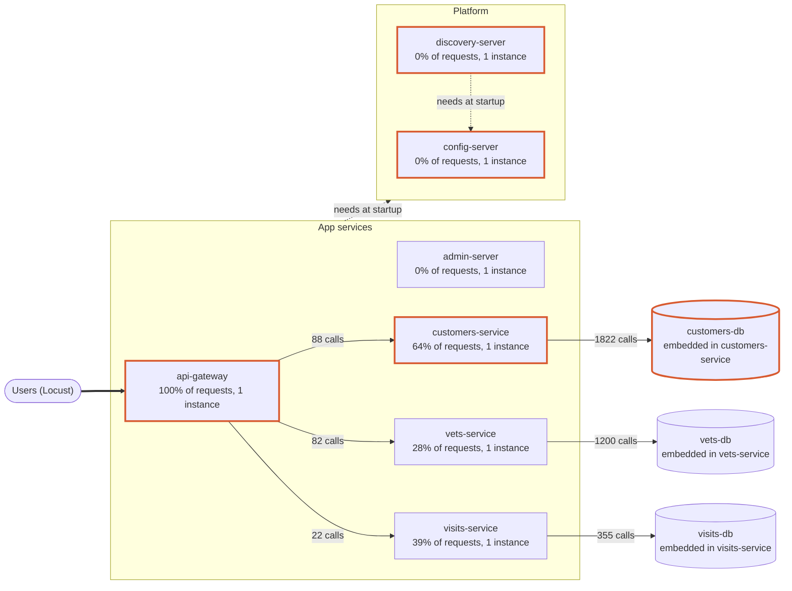

# Dependency map

Generated 2026-10-10 13:48:18. Discovered automatically from Docker Compose, Eureka, Zipkin traces and Locust traffic. Thick orange borders mark critical services: on at least half of all user requests, or needed by two or more services to start. Dashed arrows are startup dependencies or manual corrections.

## Services

| Service | Role | Share of user requests | Instances | Auto-restart | Needs at startup | Risk hints |
|---|---|---|---|---|---|---|
| api-gateway | entry point | 100% | 1 | no | config-server, discovery-server | single instance; no auto-restart; on 100% of user requests |
| customers-service | service | 64% | 1 | no | config-server, discovery-server | single instance; no auto-restart; on 64% of user requests |
| customers-db | datastore | 64% | 1 | n/a | - | embedded: fails and restarts together with customers-service; on 64% of user requests |
| visits-service | service | 39% | 1 | no | config-server, discovery-server | single instance; no auto-restart |
| visits-db | datastore | 39% | 1 | n/a | - | embedded: fails and restarts together with visits-service |
| vets-service | service | 28% | 1 | no | config-server, discovery-server | single instance; no auto-restart |
| vets-db | datastore | 28% | 1 | n/a | - | embedded: fails and restarts together with vets-service |
| admin-server | service | 0% | 1 | no | config-server, discovery-server | single instance; no auto-restart |
| config-server | platform | 0% | 1 | no | - | single instance; no auto-restart; 6 services need it to start |
| discovery-server | platform | 0% | 1 | no | config-server | single instance; no auto-restart; 5 services need it to start |

## User actions (data flows)

| User action | Route | Share of requests | Passes through | Source |
|---|---|---|---|---|
| list owners | `/api/customer/owners` | 26% | api-gateway -> customers-db -> customers-service | traces (65 traces) |
| owner details | `/api/gateway/owners/\d+` | 31% | api-gateway -> customers-db -> customers-service -> visits-db -> visits-service | manual correction (152 traces) |
| list vets | `/api/vet/vets` | 28% | api-gateway -> vets-db -> vets-service | traces (82 traces) |
| pet types | `/api/customer/petTypes` | 8% | api-gateway -> customers-db -> customers-service | traces (23 traces) |
| add visit | `/api/visit/owners/\d+/pets/\d+/visits` | 8% | api-gateway -> visits-db -> visits-service | traces (22 traces) |

## Notes and manual corrections

- 'owner details': traces only show api-gateway; added from map-overrides.json: ApiGatewayController calls customers-service and then visits-service with WebClient, but the trace context is lost on this path, so Zipkin only sees the gateway. Verified in ApiGatewayController.java.

## Sources

- **docker compose**: 11 containers, 7 app services
- **eureka**: 5 services registered
- **zipkin**: 705 traces and 6 call edges from the last 15 minutes
- **locust**: 183 user requests across 5 actions
- Not mapped (our own tooling): grafana-server, load-generator, prometheus-server, tracing-server
