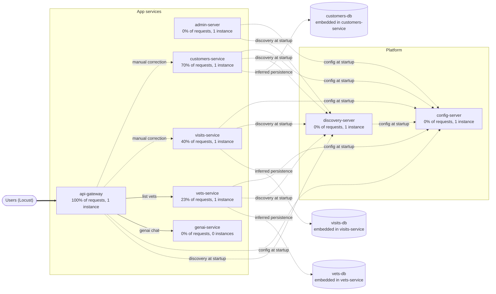

# Dependency map

Generated 2026-10-10 15:15:30. Source-backed relationships are reconciled with Docker Compose, Eureka, Zipkin, Prometheus and Locust observations. Missing telemetry is unknown, not zero impact. Dashed arrows are startup dependencies or manual corrections.

## Services

| Service | Role | Share of user requests | Instances | Auto-restart | Needs at startup | Risk hints |
|---|---|---|---|---|---|---|
| api-gateway | entry point | 100% | 1 | no | config-server, discovery-server | single instance; no auto-restart; on 100% of user requests |
| customers-service | service | 70% | 1 | no | config-server, discovery-server | single instance; no auto-restart; on 70% of user requests |
| visits-service | service | 40% | 1 | no | config-server, discovery-server | single instance; no auto-restart; on 40% of user requests |
| vets-service | service | 23% | 1 | no | config-server, discovery-server | single instance; no auto-restart; on 23% of user requests |
| admin-server | service | 0% | 1 | no | config-server, discovery-server | single instance; no auto-restart |
| config-server | platform | 0% | 1 | no | - | single instance; no auto-restart; 6 services need it to start |
| discovery-server | platform | 0% | 1 | no | config-server | single instance; no auto-restart; 5 services need it to start |
| genai-service | service | 0% | 0 | no | config-server, discovery-server | inactive profile |
| customers-db | datastore | 0% | unknown | n/a | - | datasource not verified |
| visits-db | datastore | 0% | unknown | n/a | - | datasource not verified |
| vets-db | datastore | 0% | unknown | n/a | - | datasource not verified |

## User actions (data flows)

| User action | Route | Share of requests | Passes through | Source |
|---|---|---|---|---|
| list owners | `/api/customer/owners` | 30% | api-gateway -> customers-service | unknown |
| owner details | `/api/gateway/owners/\d+` | 32% | api-gateway -> customers-service -> visits-service | manual correction |
| list vets | `/api/vet/vets` | 23% | api-gateway -> vets-service | unknown |
| pet types | `/api/customer/petTypes` | 8% | api-gateway -> customers-service | unknown |
| add visit | `/api/visit/owners/\d+/pets/\d+/visits` | 8% | api-gateway -> visits-service | unknown |

## Dependency semantics

| Consumer | Provider | Feature | Purpose | Phase | Verified | If unavailable | Evidence |
|---|---|---|---|---|---|---|---|
| api-gateway | customers-service | list owners | routing | runtime | verified | Gateway route returns its 503 fallback | spring-petclinic-microservices/spring-petclinic-api-gateway/src/main/resources/application.yml |
| api-gateway | customers-service | owner details | request_data | runtime | verified | Owner lookup has no local fallback | spring-petclinic-microservices/spring-petclinic-api-gateway/src/main/java/org/springframework/samples/petclinic/api/boundary/web/ApiGatewayController.java#getOwnerDetails |
| api-gateway | visits-service | owner details | request_data | runtime | verified | Circuit breaker can supply an empty visits list | spring-petclinic-microservices/spring-petclinic-api-gateway/src/main/java/org/springframework/samples/petclinic/api/boundary/web/ApiGatewayController.java#emptyVisitsForPets |
| api-gateway | vets-service | list vets | routing | runtime | verified | Gateway route returns its 503 fallback | spring-petclinic-microservices/spring-petclinic-api-gateway/src/main/resources/application.yml |
| api-gateway | customers-service | pet types | routing | runtime | verified | Gateway route returns its 503 fallback | spring-petclinic-microservices/spring-petclinic-api-gateway/src/main/resources/application.yml |
| api-gateway | visits-service | add visit | routing | runtime | verified | Gateway route returns its 503 fallback | spring-petclinic-microservices/spring-petclinic-api-gateway/src/main/resources/application.yml |
| api-gateway | genai-service | genai chat | routing | runtime | verified | Optional chatbot route returns its 503 fallback | spring-petclinic-microservices/spring-petclinic-api-gateway/src/main/resources/application.yml |
| discovery-server | config-server | service | configuration | startup, restart | verified | Docker-profile config import fails | spring-petclinic-microservices/spring-petclinic-discovery-server/src/main/resources/application.yml; spring-petclinic-microservices/docker-compose.yml |
| discovery-server | config-server | service | configuration | runtime | unknown | Running service may retain its loaded configuration | spring-petclinic-microservices/spring-petclinic-discovery-server/src/main/resources/application.yml; spring-petclinic-microservices/docker-compose.yml |
| customers-service | config-server | service | configuration | startup, restart | verified | Docker-profile config import fails | spring-petclinic-microservices/spring-petclinic-customers-service/src/main/resources/application.yml; spring-petclinic-microservices/docker-compose.yml |
| customers-service | config-server | service | configuration | runtime | unknown | Running service may retain its loaded configuration | spring-petclinic-microservices/spring-petclinic-customers-service/src/main/resources/application.yml; spring-petclinic-microservices/docker-compose.yml |
| visits-service | config-server | service | configuration | startup, restart | verified | Docker-profile config import fails | spring-petclinic-microservices/spring-petclinic-visits-service/src/main/resources/application.yml; spring-petclinic-microservices/docker-compose.yml |
| visits-service | config-server | service | configuration | runtime | unknown | Running service may retain its loaded configuration | spring-petclinic-microservices/spring-petclinic-visits-service/src/main/resources/application.yml; spring-petclinic-microservices/docker-compose.yml |
| vets-service | config-server | service | configuration | startup, restart | verified | Docker-profile config import fails | spring-petclinic-microservices/spring-petclinic-vets-service/src/main/resources/application.yml; spring-petclinic-microservices/docker-compose.yml |
| vets-service | config-server | service | configuration | runtime | unknown | Running service may retain its loaded configuration | spring-petclinic-microservices/spring-petclinic-vets-service/src/main/resources/application.yml; spring-petclinic-microservices/docker-compose.yml |
| api-gateway | config-server | service | configuration | startup, restart | verified | Docker-profile config import fails | spring-petclinic-microservices/spring-petclinic-api-gateway/src/main/resources/application.yml; spring-petclinic-microservices/docker-compose.yml |
| api-gateway | config-server | service | configuration | runtime | unknown | Running service may retain its loaded configuration | spring-petclinic-microservices/spring-petclinic-api-gateway/src/main/resources/application.yml; spring-petclinic-microservices/docker-compose.yml |
| admin-server | config-server | service | configuration | startup, restart | verified | Docker-profile config import fails | spring-petclinic-microservices/spring-petclinic-admin-server/src/main/resources/application.yml; spring-petclinic-microservices/docker-compose.yml |
| admin-server | config-server | service | configuration | runtime | unknown | Running service may retain its loaded configuration | spring-petclinic-microservices/spring-petclinic-admin-server/src/main/resources/application.yml; spring-petclinic-microservices/docker-compose.yml |
| genai-service | config-server | service | configuration | startup, restart | verified | Docker-profile config import fails | spring-petclinic-microservices/spring-petclinic-genai-service/src/main/resources/application.yml |
| genai-service | config-server | service | configuration | runtime | unknown | Running service may retain its loaded configuration | spring-petclinic-microservices/spring-petclinic-genai-service/src/main/resources/application.yml |
| customers-service | discovery-server | service | service_discovery | runtime, restart | inferred | Registration or lookup may fail; existing addresses may remain usable | spring-petclinic-microservices/docker-compose.yml |
| customers-service | discovery-server | service | service_discovery | startup | verified | Compose startup waits for healthy Discovery | spring-petclinic-microservices/docker-compose.yml |
| visits-service | discovery-server | service | service_discovery | runtime, restart | inferred | Registration or lookup may fail; existing addresses may remain usable | spring-petclinic-microservices/docker-compose.yml |
| visits-service | discovery-server | service | service_discovery | startup | verified | Compose startup waits for healthy Discovery | spring-petclinic-microservices/docker-compose.yml |
| vets-service | discovery-server | service | service_discovery | runtime, restart | inferred | Registration or lookup may fail; existing addresses may remain usable | spring-petclinic-microservices/docker-compose.yml |
| vets-service | discovery-server | service | service_discovery | startup | verified | Compose startup waits for healthy Discovery | spring-petclinic-microservices/docker-compose.yml |
| api-gateway | discovery-server | service | service_discovery | runtime, restart | inferred | Registration or lookup may fail; existing addresses may remain usable | spring-petclinic-microservices/docker-compose.yml |
| api-gateway | discovery-server | service | service_discovery | startup | verified | Compose startup waits for healthy Discovery | spring-petclinic-microservices/docker-compose.yml |
| admin-server | discovery-server | service | service_discovery | runtime, restart | inferred | Registration or lookup may fail; existing addresses may remain usable | spring-petclinic-microservices/docker-compose.yml |
| admin-server | discovery-server | service | service_discovery | startup | verified | Compose startup waits for healthy Discovery | spring-petclinic-microservices/docker-compose.yml |
| genai-service | discovery-server | service | service_discovery | runtime, restart | inferred | Registration or lookup may fail; existing addresses may remain usable | spring-petclinic-microservices/docker-compose.yml |
| genai-service | discovery-server | service | service_discovery | startup | verified | Compose startup waits for healthy Discovery | spring-petclinic-microservices/docker-compose.yml |
| customers-service | customers-db | service | persistence | runtime | inferred | unknown | spring-petclinic-microservices/spring-petclinic-customers-service/pom.xml |
| visits-service | visits-db | service | persistence | runtime | inferred | unknown | spring-petclinic-microservices/spring-petclinic-visits-service/pom.xml |
| vets-service | vets-db | service | persistence | runtime | inferred | unknown | spring-petclinic-microservices/spring-petclinic-vets-service/pom.xml |

## Runtime sources

- **docker compose**: available; observed 2026-10-10T09:45:30+00:00
- **docker**: available; observed 2026-10-10T09:45:30+00:00
- **eureka**: available; observed 2026-10-10T09:45:30+00:00
- **prometheus**: available; observed 2026-10-10T09:45:30+00:00
- **zipkin**: empty; observed 2026-10-10T09:45:30+00:00
- **locust**: available; observed 2026-10-10T09:45:30+00:00

## Notes and manual corrections

- 'owner details': traces only show nothing; added from map-overrides.json: ApiGatewayController calls customers-service and then visits-service with WebClient, but the trace context is lost on this path, so Zipkin only sees the gateway. Verified in ApiGatewayController.java. The active datastore behind each service is not established by this controller.
- 'list owners': no recent trace; source-backed route is retained, additional runtime calls may be unknown
- 'list vets': no recent trace; source-backed route is retained, additional runtime calls may be unknown
- 'pet types': no recent trace; source-backed route is retained, additional runtime calls may be unknown
- 'add visit': no recent trace; source-backed route is retained, additional runtime calls may be unknown

## Sources

- **docker compose**: 11 containers, 7 app services
- **eureka**: 5 services registered
- **zipkin**: 0 traces and 0 call edges from the last 15 minutes
- **locust**: 5241 user requests across 5 actions
- Not mapped (our own tooling): grafana-server, load-generator, prometheus-server, tracing-server
